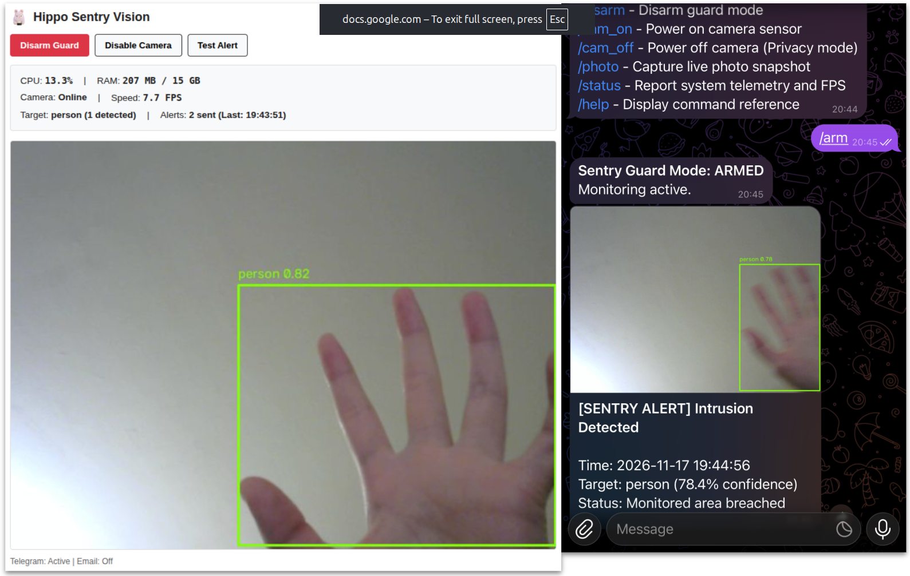

<p align="center">
  
</p>

# Hippo Sentry Vision

[](https://opensource.org/licenses/MIT)
[](https://www.python.org/)
[](https://fastapi.tiangolo.com/)
[](https://onnxruntime.ai/)
[](https://www.docker.com/)

A modular edge camera surveillance engine featuring plug-and-play object detection backends, low-latency Telegram photo notifications, privacy hardware sensor toggling, and remote bi-directional bot commands.

Designed for standalone deployment on laptops, Mini PCs, Raspberry Pi, home servers, or as a decoupled microservice for robotics and home automation.

---

<p align="center">
  
</p>

## Motivation


I have a small stuffed hippo sitting on my desk that always seems to be staring at me. Right before leaving for vacation, I needed a simple way to check on my empty room while away. Commercial smart cameras require vendor accounts, stream indoor footage to company clouds, and charge monthly fees just to store clips. Self-hosted NVRs like Frigate are solid for multi-camera setups with dedicated Coral TPUs, but way too heavy when you just want to monitor one room with a single webcam. Most scripts on GitHub were just simple one-off tutorials without two-way bot control or an easy way to shut the camera off for privacy when you get back home.

I had an old Logitech USB webcam lying around, a local Linux home server running 24/7, and that hippo on the desk. So I placed the camera next to the hippo and wrote this: a lightweight Python service using ONNX YOLO that watches the room, sends intruder photos to Telegram, lets you toggle the camera sensor on and off with `/cam_on` and `/cam_off`, and sits around ~1% CPU and under 200 MB of RAM when idle.

---

## Key Capabilities

- **Model Agnostic & Pluggable**:
  - Native support for YOLOv11, YOLOv8, and custom ONNX weights via ONNX Runtime.
  - Extendable `BaseDetector` abstract class to integrate TensorRT, OpenVINO, or custom classifiers.
  - Configurable target classes (e.g., monitor `["person"]`, domestic animals `["cat", "dog"]`, or vehicles `["car", "truck"]`).
- **Bi-Directional Telegram Bot Controls**:
  - Low-latency intrusion alert delivery with annotated JPEG snapshots.
  - Remote interactive commands:
    - `/arm` / `/disarm`: Enable or disable sentry watchdog.
    - `/cam_on` / `/cam_off`: Power toggle camera sensor on/off (Privacy mode).
    - `/photo`: Capture and deliver an on-demand live snapshot.
    - `/status`: Live system telemetry, CPU, RAM, FPS, and alert count.
- **Privacy Hardware Sensor Toggle**:
  - Disable camera sensor stream anytime via Telegram or Web UI. Replaces output with a privacy frame without exposing raw video feeds.
- **Anti-Spam Cooldown & Local Snapshot Logging**:
  - Prevents notification flooding when a target lingers in view.
  - Automatically saves timestamped intruder snapshots locally for archival records.
- **Minimalist Web Dashboard & Live MJPEG Stream**:
  - Clean, high-contrast engineering interface displaying live CPU, RAM, uptime, and telemetry alongside an MJPEG video stream.
- **Robotics & Home Automation Integration**:
  - Optional MQTT publisher and REST API endpoints to trigger actuators, companion robots, or Home Assistant automations.

---

## Architecture

```text
Camera (USB / RTSP)  ──>  YOLOv11 Engine  ──>  Sentry Watchdog  ──>  Telegram Bot
```

- **Camera Capture**: Reads frames from local USB webcam or remote RTSP stream.
- **Model Inference**: Evaluates targets using lightweight ONNX Runtime.
- **Watchdog Filter**: Checks confidence threshold and prevents notification storms via cooldown.
- **Alert Dispatch**: Sends photo snapshot with timestamp straight to Telegram.

---

## Quickstart

### 1-Click Docker Launch (Zero Python Setup)

To build and run without manual environment setup:

```bash
git clone https://github.com/maiminh1996/hippo_code.git
cd hippo_code

# Auto-generates config.yaml, downloads YOLOv11n weights, and starts Docker
./scripts/run_docker.sh
```

Or using standard Docker Compose:
```bash
cp config.example.yaml config.yaml   # Fill your Telegram token
docker compose up -d --build
```

Access the Web Dashboard at: **`http://localhost:8080`**

---

### Manual Python Installation (Optional)

```bash
# Create virtual environment
python3 -m venv .venv
source .venv/bin/activate

# Install dependencies
pip install -e .

# Download YOLOv11 ONNX weights
./scripts/download_models.sh

# Configure credentials
cp config.example.yaml config.yaml
# Edit config.yaml with bot_token and chat_id

# Run Sentry Engine & Web Dashboard
hippo-sentry run --config config.yaml
```

> **Need your Telegram Chat ID?** Run the auto-discovery utility:
> ```bash
> hippo-sentry find-chat-id --token YOUR_TELEGRAM_BOT_TOKEN
> ```

---

## Telegram Bot Commands

| Command | Action |
| :--- | :--- |
| `/arm` | Arm sentry intrusion detection |
| `/disarm` | Disarm sentry watchdog (waiting mode) |
| `/cam_on` | Power on camera sensor |
| `/cam_off` | Power off camera (Privacy Mode) |
| `/photo` | Capture and send live room snapshot |
| `/status` | System health, CPU, RAM, FPS, and alert count |
| `/help` | Display command manual |

---

## Robot & Home Assistant Integration

For connecting Smart Sentry Vision to an autonomous robot (such as an autonomous companion robot) or Home Assistant, see **[INTEGRATION.md](INTEGRATION.md)** covering:
1. **MQTT Event Bus**: Real-time reactive behaviors (alarm eyes, locomotion).
2. **REST API**: Arm/Disarm via robot voice commands.
3. **Shared MJPEG Stream**: Resolving Linux V4L2 device locks so robot and sentry share one camera.
4. **Python Library Import**: Embedding directly into custom applications.

---

## Testing

```bash
pytest tests/ -v
```

---

## License

This project is licensed under the [MIT License](LICENSE).
